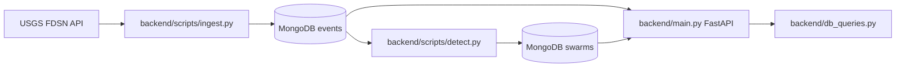
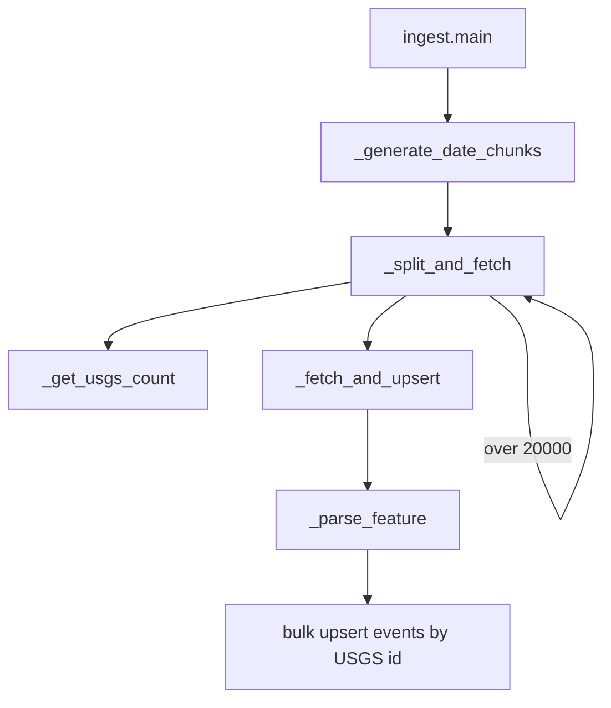
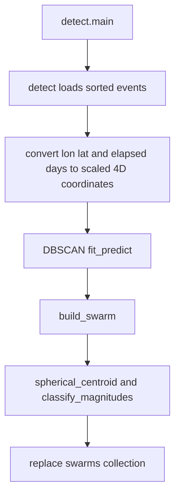
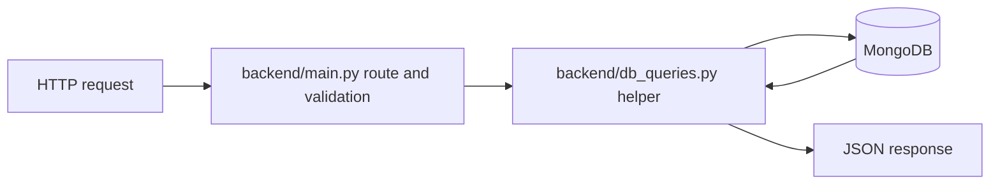
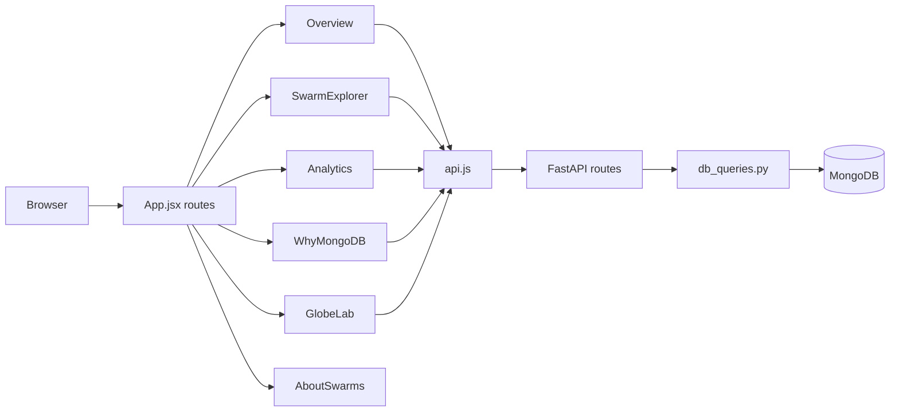

# QuakeSwarm execution flow (Phases 1–3)

This file documents the current code paths for ingestion, detection, API, and the frontend pages. Analytics is split across activity, cluster, and structure routes; About / Info combines the swarm guide and MongoDB explanation. Globe Lab is intentionally isolated in one lazy-loaded page module.

## A. Application startup

`backend/main.py` constructs the FastAPI `app`, registers CORS for Vite origins, and on startup calls `db.get_client()`, pings MongoDB, then calls `db.ensure_indexes()`. `backend/db.py` caches one `MongoClient` and provides `get_db()`. The root `main.py` forwards `main:app` to `backend.main`. The frontend starts with `cd frontend; npm install; npm run dev`; `index.html` loads `src/main.jsx`, which mounts `App` inside `BrowserRouter`.

## B. Ingestion flow

`backend/scripts/ingest.py:main()` parses `--start`, `--end`, `--minmag`, and `--chunk-days`, opens `db.get_db().events`, and calls `db.ensure_indexes()`. It gets fixed date intervals from `_generate_date_chunks()`. For each chunk, `_split_and_fetch()` calls `_get_usgs_count()`, which builds common USGS query parameters with `_build_params()` and uses `_usgs_get()` against the `/count` endpoint. Counts above 20,000 are divided recursively at the midpoint. For smaller non-empty intervals it compares the database count in the time range and skips downloading when that count equals the USGS count.

Intervals needing retrieval go through `_fetch_and_upsert()`: it calls the USGS `/query` endpoint through `_usgs_get()`, parses GeoJSON features with `_parse_feature()`, validates required id, time, magnitude and finite coordinate values, and maps `[lon, lat, depth]` to a MongoDB document with a GeoJSON Point. Invalid features increment `counters['skipped']`; valid events use `UpdateOne` with `upsert=True`, keyed by USGS `_id`, and are sent with `bulk_write()`. The count parser accepts the plain integer and JSON-object response shapes from the USGS count endpoint. Existing-count checks include the requested magnitude threshold. The script prints progress, inserted/modified/skipped counts, and the final events document count.

## C. Swarm detection flow

`backend/scripts/detect.py:main()` parses the DBSCAN overrides and calls `detect()`. `detect()` loads valid time/magnitude/location documents from MongoDB and sorts them by time. It deletes the old `swarms` documents before handling empty/tiny input. For each event it converts longitude/latitude to radians, computes Earth-centered `x/y/z` kilometers using Earth radius 6371 km, calculates days since the first event, and appends `elapsed_days * (space_km / time_days)` as the time coordinate. It runs scikit-learn `DBSCAN` with Euclidean distance, `eps=space_km` and `min_samples=min_events`.

Noise label `-1` is dropped. Each other label is passed to `build_swarm()`, which obtains a spherical centroid via `spherical_centroid()`, computes great-circle distances for `radius_km`, duration, bbox, event ids and the largest event label. `classify_magnitudes()` determines `max_mag`, `second_mag`, `mag_gap` and kind using the configured gap threshold; a cluster without two magnitudes is `unclassified`. Documents are inserted into `swarms`, and counts per kind are printed. This is a heuristic, not an authoritative seismological classification or prediction. The implementation currently runs the entire dataset in memory; no year-window fallback is implemented.

## D. Backend API flow

Routes in `backend/main.py` validate query inputs and call same-purpose helpers in `backend/db_queries.py`:

| Request | Route | Helper / database operation |
|---|---|---|
| `GET /api/health` | `health()` | `db_queries.health()` pings MongoDB |
| `GET /api/indexes` | `indexes()` | `db_queries.indexes()` reads current index definitions for `events` and `swarms` |
| `GET /api/stats` | `stats()` | `db_queries.stats()` counts documents and aggregates min/max event times |
| `GET /api/events` | `events()` | `db_queries.events()` applies `$geoWithin` + `$box`, date/magnitude filters, sort and limit; `_event_doc()` maps GeoJSON coordinates to `lat`/`lon` |
| `GET /api/swarms` | `swarms()` | `db_queries.swarms()` filters and excludes `event_ids` |
| `GET /api/swarms/{swarm_id}` | `swarm_detail()` | `db_queries.swarm_detail()` loads the cluster and its event documents |
| `GET /api/timeline` | `timeline()` | `db_queries.timeline()` groups events with `$dateToString` by year/month |
| `GET /api/analytics/magnitude-distribution` | `magnitude_distribution()` | `db_queries.magnitude_distribution()` buckets magnitudes at 0.5 intervals |
| `GET /api/analytics/depth-distribution` | `depth_distribution()` | `db_queries.depth_distribution()` facets depth buckets and null-depth count |
| `GET /api/analytics/magnitude-depth` | `magnitude_depth()` | `db_queries.magnitude_depth()` samples at most 5000 non-null depths |
| `GET /api/analytics/regions` | `regions()` | `db_queries.regions()` groups using place text after its last comma |
| `GET /api/analytics/magnitude-types` | `magnitude_types()` | `db_queries.magnitude_types()` groups null as `Not available` |
| `GET /api/analytics/swarm-summary` | `swarm_summary()` | `db_queries.swarm_summary()` aggregates cluster counts and averages |
| `GET /api/analytics/swarm-scatter` | `swarm_scatter()` | `db_queries.swarm_scatter()` projects scatter fields |
| `GET /api/analytics/swarm-timeline` | `swarm_timeline()` | `db_queries.swarm_timeline()` groups swarm starts by period and kind |
| `GET /api/analytics/swarm-radius` | `swarm_radius()` | `db_queries.swarm_radius()` buckets stored radii in 10 km groups |
| `GET /api/analytics/inter-event-times` | `inter_event_times()` | `db_queries.inter_event_times()` loads each cluster's event times and counts gaps in hour bins |
| `GET /api/benchmark` | `benchmark()` | `db_queries.benchmark()` compares a 2dsphere-hinted query to `$natural` and reads `executionStats` |

The API validates date order, bounding boxes, enum parameters and limits. FastAPI returns HTTP 422 for invalid typed/range parameters. Missing swarm IDs return 404.

## E. Frontend flow

`frontend/index.html` loads `frontend/src/main.jsx`, which imports Leaflet CSS and the shared styles, then mounts `App` inside `BrowserRouter`. `App` checks `/api/health` through `apiRequest()` and provides shared navigation. Analytics, Swarm Explorer, Why MongoDB, About Swarms, and Globe Lab are loaded with `React.lazy`. `api.js` is the shared API/static-asset request module and `useApiResource.js` provides abortable loading/error/retry state for query-backed views.

Overview requests `/api/stats` first. It derives the default date window from `last_event_time` (one year back through the last stored event date), then calls `/api/events` with `min_mag=4.5`, `sort=mag_desc`, and `limit=2000`, and `/api/timeline?granularity=month` with the same dates and magnitude. Date and magnitude controls refetch the relevant data. The Earthquakes/Swarms toggle requests `/api/events` or `/api/swarms`; no whole event collection is sent to the browser.

`components/EventMap.jsx` renders Leaflet tiles, magnitude-sized earthquake circles, swarm circles, and diamond markers for mainshock sequences. Clicking a swarm requests `/api/swarms/{id}`; the response fills detail and overlays member events. `components/ActivityChart.jsx` is lazy-loaded after monthly data is available and uses the Plotly basic bundle and `plotTheme.js`.

`pages/SwarmExplorer.jsx` requests `/api/swarms` with kind/date/minimum-event/sort filters. It loads `/countries.json` through `api.js`, then `geography.js` assigns each cluster centroid to a Natural Earth country and continent. Country, continent, maximum-event-count, magnitude, and duration filters are applied locally. The catalog is shown as paginated cards. Selecting a card opens `/api/swarms/{id}`; returned events supply the regional Leaflet map, magnitude-time scatter, daily-count chart, and chronological table. `pages/Analytics.jsx` renders charts 1–7 from event analytics routes and charts 8–12 from swarm analytics routes. It groups date/magnitude filters for earthquake activity and date/kind filters for swarm results and structure. All date controls are bounded to 2015-01-01 through 2025-12-31 and magnitude controls start at M 2.5. `pages/WhyMongoDB.jsx` reads actual collection indexes from `/api/indexes`; its button calls `/api/benchmark` and displays returned timing and execution statistics. `pages/AboutSwarms.jsx` explains the configured catalog and detection thresholds. `StateMessage.jsx` renders loading, error/retry, and unavailable states with context-specific messages.

`pages/GlobeLab.jsx` is the only file importing `react-globe.gl`. It requests `/api/events` with a limit of 800 and `/api/swarms`, displaying up to 200 cluster centers for a 1,000 marker maximum. Its click panel sits beside the globe at desktop widths and shows earthquake or cluster fields from those records. The initial camera points toward North America; CSS brightens and softens the texture display. The page is lazy-loaded and removable with its route, nav link and dependency. `ActivityChart.jsx` plots monthly event counts as a filled line with a UTC date axis.

## F. Benchmark flow

The benchmark is triggered by `GET /api/benchmark` and handled by `main.benchmark()` → `db_queries.benchmark()`. It uses the same `$geoWithin` box and time filter for each query, forces the location 2dsphere index with a hint for the indexed case and forces natural collection order for the scan case. It performs a warm-up query, collects wall-clock milliseconds for the requested repetitions, and reads `totalDocsExamined` and `nReturned` from MongoDB's `explain` command with `executionStats` verbosity. It prints and returns the indexed returned count alongside both result objects. Actual measurements require a running MongoDB database containing events.

## G. Function-call mapping

- Startup: `main.startup() → db.get_client() → MongoClient.admin.command('ping') → db.ensure_indexes() → db.get_db()`
- Ingestion: `ingest.main() → _generate_date_chunks() → _split_and_fetch() → _get_usgs_count() → _build_params() → _usgs_get()`
- Fetch/storage: `_split_and_fetch() → _fetch_and_upsert() → _usgs_get() → _parse_feature() → collection.bulk_write(UpdateOne(..., upsert=True))`
- Detection: `detect.main() → detect() → DBSCAN.fit_predict() → build_swarm() → spherical_centroid() + classify_magnitudes() → swarms.insert_many()`
- Events API: `main.events() → main.validate_dates()/check_box() → db_queries.events() → _event_doc()`
- Frontend startup: `src/main.jsx → App.jsx → apiRequest('/api/health') → Overview.jsx`
- Overview data: `Overview.jsx → apiRequest('/api/stats') → default date window → apiRequest('/api/events') + apiRequest('/api/timeline') → EventMap.jsx + ActivityChart.jsx`
- Marker selection: `EventMap.jsx → Overview.selectMarker() → apiRequest('/api/swarms/{id}') → selected detail panel + constituent-event map overlay`
- Analytics: each `main` analytics route → corresponding `db_queries` function → MongoDB aggregation or find
- Swarm catalog/detail: `SwarmExplorer.jsx → apiRequest('/api/swarms') → row selection → apiRequest('/api/swarms/{id}') → regional map + charts + event table`
- Database explainer: `WhyMongoDB.jsx → apiRequest('/api/indexes')`; button → `apiRequest('/api/benchmark') → Plotly chart + execution stats`
- Globe: `GlobeLab.jsx → apiRequest('/api/events', limit=800) + apiRequest('/api/swarms') → normalized marker objects → react-globe.gl → selected-record panel`
- Benchmark: `main.benchmark() → db_queries.benchmark() → hinted find().explain('executionStats')`

## H. Relationships and data shapes

| Path | Responsibility |
|---|---|
| `backend/config.py` | MongoDB, USGS, ingestion, detection and benchmark defaults |
| `backend/db.py` | Shared connection and required indexes |
| `backend/main.py` | FastAPI startup, CORS, validation and endpoint routing |
| `backend/db_queries.py` | Database query and aggregation functions |
| `backend/scripts/ingest.py` | USGS requests, input validation and event upserts |
| `backend/scripts/detect.py` | Coordinate scaling, clustering and swarm persistence |
| `backend/requirements.txt` | Pinned Python dependencies |
| `frontend/src/api.js` | Shared API URL and request/error handling |
| `frontend/src/pages/Overview.jsx` | Overview queries, filters and selected-marker detail |
| `frontend/src/components/EventMap.jsx` | Leaflet map and earthquake/swarm marker presentation |
| `frontend/src/components/ActivityChart.jsx` | Lazy Plotly monthly activity chart |
| `frontend/src/pages/SwarmExplorer.jsx` | Filtered cluster list, detail charts, regional map and event table |
| `frontend/src/pages/Analytics.jsx` | Twelve charts backed by analytics API responses |
| `frontend/src/pages/WhyMongoDB.jsx` | Live index listing and benchmark interaction/results |
| `frontend/src/pages/GlobeLab.jsx` | Isolated lazy-loaded 3D globe and bounded markers |
| `frontend/src/pages/AboutSwarms.jsx` | Human-readable catalog and clustering method guide |
| `frontend/src/catalog.js` | UI catalog bounds and mirrored clustering defaults |
| `frontend/src/geography.js` | Country/continent lookup for swarm centroid coordinates |
| `frontend/public/countries.json` | Public-domain Natural Earth 1:110m country boundaries, fetched on the Swarm Explorer page |
| `frontend/src/components/PlotlyChart.jsx` | Shared Plotly React wrapper |
| `frontend/src/components/ChartPanel.jsx` | Analytics chart title, description and states |
| `frontend/src/components/FilterBar.jsx` | Shared date, magnitude, cluster kind and sort inputs |
| `frontend/src/hooks/useApiResource.js` | Abortable resource loading with retry/error state |
| `frontend/src/plotTheme.js` | Shared Plotly colors, fonts and layout defaults |
| `frontend/src/styles.css` | Design tokens, responsive layout and state styling |

Frontend relationships: `App.jsx` routes to the page modules; Overview composes `EventMap` and `ActivityChart`; Swarm Explorer composes `RegionalSwarmMap`, `ChartPanel`, `PlotlyChart`, and `FilterBar`, with country lookup data from `geography.js`; Analytics composes `ChartPanel`, `PlotlyChart`, and `FilterBar`; Why MongoDB composes `PlotlyChart`; About Swarms reads display thresholds from `catalog.js`; Globe Lab uses `react-globe.gl` only inside its own page module. Data requests flow through `api.js` directly or through `useApiResource.js`.

Key event shape: `{_id, time, mag, mag_type, place, depth_km, location: {type: "Point", coordinates: [lon, lat]}, url}`. Key swarm shape: `{_id, start, end, duration_days, n_events, centroid, bbox, radius_km, max_mag, second_mag, mag_gap, kind, event_ids, label}`. `GET /api/events` maps coordinates to `lat` and `lon`; `GET /api/swarms` omits `event_ids`; the detail route includes `events` alongside the stored swarm fields.
