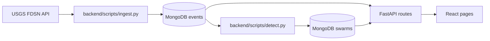
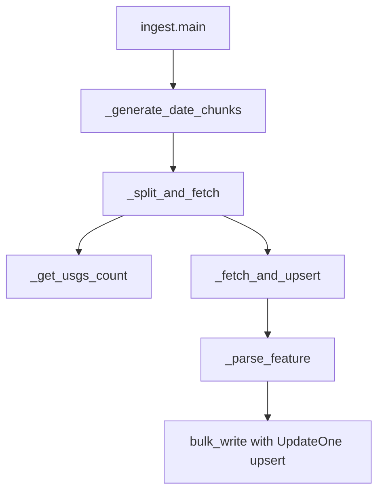
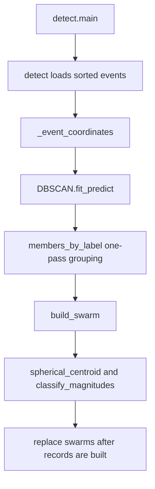
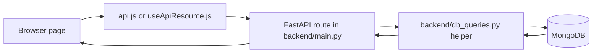

# QuakeSwarm execution flow

This document follows the checked-in implementation. The system ingests USGS events, detects spatial-temporal clusters, serves MongoDB-backed API responses, and renders them in a React application.

## A. Startup

`backend/main.py` constructs the FastAPI `app`, configures local Vite CORS origins, and registers `startup()`. Startup calls `db.get_client()`, pings MongoDB, and calls `db.ensure_indexes()`. `db.get_db()` returns the configured database. The repository-root `main.py` forwards to `backend.main`. The frontend entry `frontend/src/main.jsx` mounts `App` inside `BrowserRouter`.

## B. Ingestion

`backend/scripts/ingest.py:main()` parses the range, magnitude floor, and chunk size; opens the events collection; and ensures indexes. `_generate_date_chunks()` splits the requested interval. For each chunk, `_split_and_fetch()` gets the USGS count through `_get_usgs_count()`, which builds parameters with `_build_params()` and sends requests through `_usgs_get()`. Chunks over the USGS request limit are recursively divided. Complete chunks already represented in MongoDB are skipped.

Chunks needing retrieval go through `_fetch_and_upsert()`. `_parse_feature()` validates each USGS GeoJSON feature and maps its coordinates to a MongoDB GeoJSON Point. Valid records are idempotently written with `UpdateOne(..., upsert=True)` and `bulk_write()` using the USGS event ID.

## C. Detection

`backend/scripts/detect.py:main()` validates detection overrides and calls `detect()`. `detect()` loads valid events in time order and prepares scaled Earth-centered spatial coordinates plus elapsed time. It applies scikit-learn `DBSCAN` with the configured spatial and temporal scales and minimum event count. Noise label `-1` is ignored. `members_by_label` groups cluster members in one pass; `build_swarm()` calculates spherical centroid, radius, time span, bounds, member IDs, and magnitude values.

A cluster is `mainshock_sequence` if its magnitude gap is at least `MAG_GAP_THRESHOLD` (1.2), or if its maximum magnitude is at least `EARLY_MAINSHOCK_MAGNITUDE` (6.0) and that event is within `EARLY_MAINSHOCK_FRACTION` (0.25) of the cluster's start-to-end time span. Otherwise it is `swarm`. When the gap cannot be computed because fewer than two magnitudes are available, it is `unclassified`. This classification is a heuristic. New swarm documents are computed before the previous collection contents are deleted.

## D. API routes

`backend/main.py` validates query parameters and delegates to same-purpose functions in `backend/db_queries.py`.

| Route | Route function | Query helper |
|---|---|---|
| `GET /api/health` | `health()` | `health()` |
| `GET /api/indexes` | `indexes()` | `indexes()` |
| `GET /api/stats` | `stats()` | `stats()` |
| `GET /api/events` | `events()` | `events()` |
| `GET /api/swarms` | `swarms()` | `swarms()` |
| `GET /api/swarms/{swarm_id}` | `swarm_detail()` | `swarm_detail()` |
| `GET /api/timeline` | `timeline()` | `timeline()` |
| `GET /api/analytics/magnitude-distribution` | `magnitude_distribution()` | `magnitude_distribution()` |
| `GET /api/analytics/depth-distribution` | `depth_distribution()` | `depth_distribution()` |
| `GET /api/analytics/magnitude-depth` | `magnitude_depth()` | `magnitude_depth()` |
| `GET /api/analytics/regions` | `regions()` | `regions()` |
| `GET /api/analytics/magnitude-types` | `magnitude_types()` | `magnitude_types()` |
| `GET /api/analytics/swarm-summary` | `swarm_summary()` | `swarm_summary()` |
| `GET /api/analytics/swarm-scatter` | `swarm_scatter()` | `swarm_scatter()` |
| `GET /api/analytics/swarm-timeline` | `swarm_timeline()` | `swarm_timeline()` |
| `GET /api/analytics/swarm-radius` | `swarm_radius()` | `swarm_radius()` |
| `GET /api/analytics/inter-event-times` | `inter_event_times()` | `inter_event_times()` |

Date and bounding-box validation errors return HTTP 422. A missing cluster detail returns HTTP 404. The `/api/indexes` route returns index metadata directly from MongoDB.

## E. Frontend

`src/main.jsx` imports Leaflet styles and the shared stylesheet, then mounts `App`. `App` provides navigation and checks `/api/health`. Analytics, Swarm Explorer, About / Info, and Globe Lab are lazy-loaded. The Analytics page has separate activity, cluster, and structure routes with independent filter state. `FilterBar` and `useApiResource` provide query controls and loading, error/retry, empty, and unavailable states.

Overview loads `/api/stats`, then requests date- and magnitude-filtered events and timeline data. `EventMap` renders earthquake and cluster markers; marker selection can request cluster details. Swarm Explorer requests filtered cluster rows, uses `geography.js` and Natural Earth boundaries to map centroid coordinates to countries and continents, and requests member event details for a selected cluster. Its catalog supports geographic, event count, magnitude, and duration filters.

Analytics charts query the corresponding event and cluster routes. Depth and magnitude-type categories use reduced angled ticks; the duration/event-count scatter uses logarithmic axes; radius uses a numeric axis; inter-event gap bins include intervals below 0.01 hour. About / Info combines `AboutSwarms.jsx` and `WhyMongoDB.jsx`. The latter reads live index metadata from `/api/indexes` and describes the collection model, spatial/time indexes, and aggregation pipelines. Globe Lab is the only module importing `react-globe.gl`; it requests bounded event and swarm marker sets.

## F. Function map

- Startup: `backend.main.startup()` → `db.get_client()` → MongoDB ping → `db.ensure_indexes()`
- Ingestion: `ingest.main()` → `_generate_date_chunks()` → `_split_and_fetch()` → `_get_usgs_count()` / `_fetch_and_upsert()` → `_parse_feature()` → `bulk_write()`
- Detection: `detect.main()` → `detect()` → `DBSCAN.fit_predict()` → one-pass `members_by_label` grouping → `build_swarm()` → `spherical_centroid()` / `classify_magnitudes()` → replace `swarms`
- API: `backend.main` route → corresponding `backend.db_queries` helper → MongoDB find or aggregation → JSON
- Browser: `src/main.jsx` → `App` routes → page module → `api.js` or `useApiResource.js` → FastAPI

## G. Data model and relationships

An event document has fields such as `{_id, time, mag, mag_type, place, depth_km, location: {type: "Point", coordinates: [lon, lat]}, url}`. A swarm document stores `{_id, start, end, duration_days, n_events, centroid, bbox, radius_km, max_mag, second_mag, mag_gap, kind, event_ids, label}`. Event records remain in `events`; swarm documents reference event IDs and the detail route resolves them.

| Path | Responsibility |
|---|---|
| `backend/config.py` | MongoDB, USGS, ingestion, and detection defaults |
| `backend/db.py` | Shared MongoDB connection and indexes |
| `backend/main.py` | FastAPI startup, validation, and routes |
| `backend/db_queries.py` | Database query and aggregation functions |
| `backend/scripts/ingest.py` | USGS requests, validation, and event upserts |
| `backend/scripts/detect.py` | Coordinate scaling, clustering, classification, and persistence |
| `backend/tests/` | API, ingestion, database-query, and detection tests |
| `frontend/src/main.jsx` | React entry point and router mount |
| `frontend/src/App.jsx` | Navigation, routes, and page loading |
| `frontend/src/api.js` | Shared API and static-asset request handling |
| `frontend/src/components/EventMap.jsx` | Overview event and cluster map |
| `frontend/src/components/ActivityChart.jsx` | Overview monthly activity chart |
| `frontend/src/components/FilterBar.jsx` | Date, magnitude, kind, and sort controls |
| `frontend/src/components/ChartPanel.jsx` | Chart headings and request states |
| `frontend/src/components/PlotlyChart.jsx` | Plotly React wrapper |
| `frontend/src/pages/Analytics.jsx` | Activity, cluster, and structure charts |
| `frontend/src/pages/SwarmExplorer.jsx` | Cluster filters, details, map, and event charts |
| `frontend/src/pages/AboutInfo.jsx` | Combined About / Info sections |
| `frontend/src/pages/AboutSwarms.jsx` | Catalog, classification, and coverage guide |
| `frontend/src/pages/WhyMongoDB.jsx` | Collection explanation and live index listing |
| `frontend/src/pages/GlobeLab.jsx` | Isolated 3D globe view |
| `frontend/src/geography.js` and `frontend/public/countries.json` | Country/continent assignment for cluster centroids |
