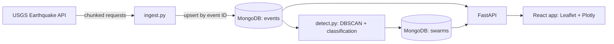

# QuakeSwarm

**Detect and explore earthquake swarms in a large public earthquake catalog.**

QuakeSwarm downloads real earthquake events from the [USGS Earthquake Catalog](https://earthquake.usgs.gov/fdsnws/event/1/), stores them in MongoDB, finds clusters of events that are close in both space and time using DBSCAN, and presents the results in an interactive web app (React + FastAPI).

> Built as a Big Data Analytics course project. The cluster labels are a transparent heuristic for data exploration, not an authoritative seismological classification and not a prediction tool.


---

## Table of contents

- [Features](#features)
- [How it works](#how-it-works)
- [Data and method](#data-and-method)
- [Results snapshot](#results-snapshot)
- [Tech stack](#tech-stack)
- [Getting started](#getting-started)
- [Configuration](#configuration)
- [API reference](#api-reference)
- [Project structure](#project-structure)
- [Testing](#testing)
- [Known limitations](#known-limitations)
- [Possible future work](#possible-future-work)


---

## Features

- **Chunked USGS ingestion:** counts first, splits time windows when a request would exceed the USGS 20,000-event limit, and upserts by USGS event ID so re-runs never create duplicates.
- **Spatial-temporal clustering:** DBSCAN on 3D Earth coordinates plus scaled time, with configurable distance, time window and minimum cluster size.
- **Swarm vs mainshock-sequence labelling** using the magnitude gap and an early-large-event rule.
- **Overview map** (Leaflet) of earthquakes or detected clusters, with date and magnitude filters.
- **Swarm Explorer:** filter and sort clusters, open a detail page with a regional map, event timeline and statistics.
- **12 Plotly analytics charts** across three pages: earthquake activity, swarm results, swarm structure.
- **About / Info** pages explaining the method, the data limits and the MongoDB data model (index list read live from the database).
- **Globe Lab (experimental):** an isolated, removable 3D globe view.
- Clear *loading*, *error*, *not available* and *not applicable* states instead of fabricated zeros.


## How it works



For a line-by-line walkthrough of the code paths, function calls and diagrams, see [FLOW.md](FLOW.md).

## Data and method

**Data source:** USGS FDSN Event Web Service (`https://earthquake.usgs.gov/fdsnws/event/1/`), GeoJSON format, `eventtype=earthquake`. The configured catalog covers **2015-01-01 to 2025-12-31** with **magnitude 2.5 and above**.

**Ingestion** (`backend/scripts/ingest.py`): for each time window the script calls the USGS `count` endpoint. If the count exceeds 20,000 the window is split in half and retried. Records with missing id, time, coordinates or magnitude are skipped and counted. Optional fields (depth, magnitude type, place) stay `null` when absent.

**Detection** (`backend/scripts/detect.py`):

1. Convert each event's latitude/longitude to 3D coordinates in kilometres (Earth radius 6,371 km).
2. Convert time to days since the first event and scale it so that **7 days is equivalent to 15 km**.
3. Run DBSCAN on `[x, y, z, scaled_time]` with `eps = 15` and `min_samples = 20`.
4. For each cluster compute start, end, duration, event count, centroid (average of unit-sphere vectors, so clusters near ±180° longitude stay correct), bounding box, radius, largest and second-largest magnitude, and the magnitude gap.

**Classification rule:**

- `mainshock_sequence` if the largest magnitude exceeds the second-largest by **at least 1.2**, **or** the largest event is **at least M6.0** and occurs in the **first 25%** of the cluster's time span.
- Otherwise `swarm`.
- `unclassified` if the magnitude gap cannot be computed.

All thresholds are configurable (see [Configuration](#configuration)).

**MongoDB model:** `events` stores one document per earthquake with a GeoJSON Point; `swarms` stores one document per cluster with its member event IDs. Indexes: `events.location` (2dsphere), `events.time`, `events.mag`, `swarms.start`.

## Results snapshot

Measurements from the author's local run (they depend on the database contents and settings; re-running ingestion or detection may change them):

| Item | Value |
|---|---|
| Stored earthquake events | 310,333 |
| Event document storage | 83,279,944 bytes (about 79.4 MiB, excluding indexes) |
| Detected clusters | 425 |
| Swarms | 293 |
| Mainshock sequences | 132 |
| Unclassified | 0 |

## Tech stack

| Layer | Technology |
|---|---|
| Database | MongoDB (local or Atlas) |
| Backend | Python 3.10+, FastAPI, PyMongo, NumPy, scikit-learn |
| Frontend | React, Vite, React Router, Leaflet / react-leaflet, Plotly (basic bundle) |
| Experimental | react-globe.gl (Globe Lab only) |
| Tests | pytest |

## Getting started

### Prerequisites

- Python 3.10 or newer
- Node.js 22.12 or newer (see `engines` in `frontend/package.json`)
- A running MongoDB instance (local) or a MongoDB Atlas connection string

### 1. Clone and configure

```bash
git clone https://github.com/033-Archita/QuakeSwarm.git
cd QuakeSwarm

# backend configuration
cp backend/.env.example backend/.env      # Windows PowerShell: Copy-Item backend/.env.example backend/.env
# edit backend/.env and set MONGODB_URI and DB_NAME

# frontend configuration (optional; default is http://localhost:8000)
cp frontend/.env.example frontend/.env
```

### 2. Install and start the backend

```bash
python -m pip install -r backend/requirements.txt
python -m uvicorn main:app --reload
```

The API runs at `http://127.0.0.1:8000` and interactive docs are at `http://127.0.0.1:8000/docs`. On macOS/Linux use `python3` if `python` is not available.

### 3. Load data and detect swarms

In a second terminal, from the repository root:

```bash
python -m backend.scripts.ingest      # downloads the configured USGS catalog
python -m backend.scripts.detect      # runs DBSCAN and writes the swarms collection
```

Useful options:

```bash
# small test range
python -m backend.scripts.ingest --start 2024-01-01 --end 2024-03-01 --minmag 4.0

# detection options
python -m backend.scripts.detect --help
```

The full 2015–2025 ingestion at M2.5+ downloads hundreds of thousands of events and takes a while. Try a small range first.

### 4. Start the frontend

```bash
cd frontend
npm install
npm run dev
```

Open `http://127.0.0.1:5173`.

## Configuration

**Environment variables**

| File | Variable | Default | Purpose |
|---|---|---|---|
| `backend/.env` | `MONGODB_URI` | `mongodb://localhost:27017` | MongoDB connection string |
| `backend/.env` | `DB_NAME` | `quakeswarm` | Database name |
| `frontend/.env` | `VITE_API_URL` | `http://localhost:8000` | Backend base URL |

Never commit `.env` files; they are listed in `.gitignore`.

**Application settings** (`backend/config.py`)

| Setting | Default | Meaning |
|---|---|---|
| `DEFAULT_START` / `DEFAULT_END` | 2015-01-01 / 2025-12-31 | Ingestion window |
| `DEFAULT_MIN_MAG` | 2.5 | Minimum magnitude downloaded |
| `DEFAULT_CHUNK_DAYS` | 60 | Initial time-window size |
| `REQUEST_PAUSE_SEC` | 0.5 | Pause between USGS requests |
| `SPACE_KM` | 15 | DBSCAN neighbourhood radius (km) |
| `TIME_DAYS` | 7 | Time window equivalent to `SPACE_KM` |
| `MIN_EVENTS` | 20 | Minimum events per cluster |
| `MAG_GAP_THRESHOLD` | 1.2 | Magnitude gap marking a mainshock sequence |
| `EARLY_MAINSHOCK_MAGNITUDE` | 6.0 | Magnitude for the early-mainshock rule |
| `EARLY_MAINSHOCK_FRACTION` | 0.25 | Early part of the cluster's time span |

## API reference

All endpoints return JSON. Invalid dates, bounding boxes or query values return HTTP 422; an unknown swarm ID returns 404.

| Endpoint | Description |
|---|---|
| `GET /api/health` | Backend and database status |
| `GET /api/stats` | Event count, first/last event time, swarm counts |
| `GET /api/indexes` | Index definitions read from MongoDB |
| `GET /api/events` | Events filtered by bounding box, dates, minimum magnitude, sort, limit (default 2,000; max 10,000) |
| `GET /api/swarms` | Detected clusters (filter by kind, minimum events, dates; sort) |
| `GET /api/swarms/{id}` | One cluster with its member events |
| `GET /api/timeline` | Events per year or month |
| `GET /api/analytics/magnitude-distribution` | Magnitude histogram |
| `GET /api/analytics/depth-distribution` | Depth histogram |
| `GET /api/analytics/magnitude-depth` | Sample of magnitude vs depth |
| `GET /api/analytics/regions` | Top regions by event count |
| `GET /api/analytics/magnitude-types` | Counts by magnitude type |
| `GET /api/analytics/swarm-summary` | Cluster counts and averages by kind |
| `GET /api/analytics/swarm-scatter` | Duration vs event count per cluster |
| `GET /api/analytics/swarm-timeline` | Clusters started per year or month |
| `GET /api/analytics/swarm-radius` | Cluster radius distribution |
| `GET /api/analytics/inter-event-times` | Gaps between consecutive events inside clusters |

## Project structure

```
QuakeSwarm/
├── main.py                  # root entry point: forwards to backend.main
├── README.md
├── FLOW.md                  # code execution flow and function-call maps
├── backend/
│   ├── main.py              # FastAPI routes and request validation
│   ├── config.py            # connection, ingestion and detection settings
│   ├── db.py                # MongoDB client and index creation
│   ├── db_queries.py        # query and aggregation helpers
│   ├── scripts/
│   │   ├── ingest.py        # USGS download, validation, upsert
│   │   └── detect.py        # DBSCAN clustering and classification
│   └── tests/               # pytest tests
└── frontend/
    └── src/
        ├── App.jsx          # routes and navigation
        ├── api.js           # API client
        ├── pages/           # Overview, SwarmExplorer, Analytics, AboutInfo, GlobeLab
        └── components/      # map, charts, filters, state messages
```

## Testing

```bash
# backend tests (from the repository root)
python -m pytest -p no:cacheprovider backend/tests

# frontend production build
cd frontend
npm run build
```

The backend tests use fakes and monkeypatching, so they do not need a running MongoDB. They cover classification, centroid handling at the dateline, empty and tiny detection inputs, USGS chunk splitting, record parsing, inter-event binning and API validation. Browser behaviour (layout, map interaction, WebGL) should be checked manually with the backend and frontend running.

## Known limitations

- **Uneven catalog coverage:** USGS publishes M2.5+ events for the United States but roughly M4.0+ elsewhere. Low-magnitude results (including the top-regions chart and the dip around M3.5–4.0 in the magnitude distribution) therefore over-represent US areas. The catalog is not adjusted for this.
- **Heuristic labels:** cluster kinds depend on the distance, time, size and magnitude thresholds. Some real aftershock sequences may be labelled `swarm` and vice versa.
- **In-memory clustering:** DBSCAN processes all valid events in memory.
- **Region names** in the analytics come from the text after the last comma in the USGS `place` field, which is a display heuristic.
- **Bounding boxes** of clusters crossing ±180° longitude can be misleading (centroids are computed correctly).
- **Historical data:** the stored catalog ends on 2025-12-31; the app does not stream live events.
- **Globe Lab** is experimental and loads a large WebGL bundle on demand. To remove it, delete `frontend/src/pages/GlobeLab.jsx`, its route and navigation link in `frontend/src/App.jsx`, and the `react-globe.gl` dependency.

## Possible future work

- A parameter-sensitivity study for distance, time window and minimum cluster size.
- Comparison with established earthquake-clustering methods.
- Deployment with a hosted database and an environment-configurable CORS origin list.

## Acknowledgements

- Data: [USGS Earthquake Catalog](https://earthquake.usgs.gov/earthquakes/feed/v1.0/)
- Maps: [Leaflet](https://leafletjs.com/) and [OpenStreetMap](https://www.openstreetmap.org/copyright) tiles
- Charts: [Plotly basic distribution](https://www.npmjs.com/package/plotly.js-basic-dist-min)
- Globe texture: [NASA Blue Marble Next Generation](https://science.nasa.gov/earth/earth-observatory/blue-marble-next-generation/base-topography/)
- Country boundaries: [Natural Earth](https://www.naturalearthdata.com/about/terms-of-use/)
- Clustering background: Ester et al. (1996), DBSCAN, KDD-96; Birant & Kut (2007), *ST-DBSCAN: An algorithm for clustering spatial–temporal data*, Data & Knowledge Engineering 60(1), 208–221, [doi:10.1016/j.datak.2006.01.013](https://doi.org/10.1016/j.datak.2006.01.013)
